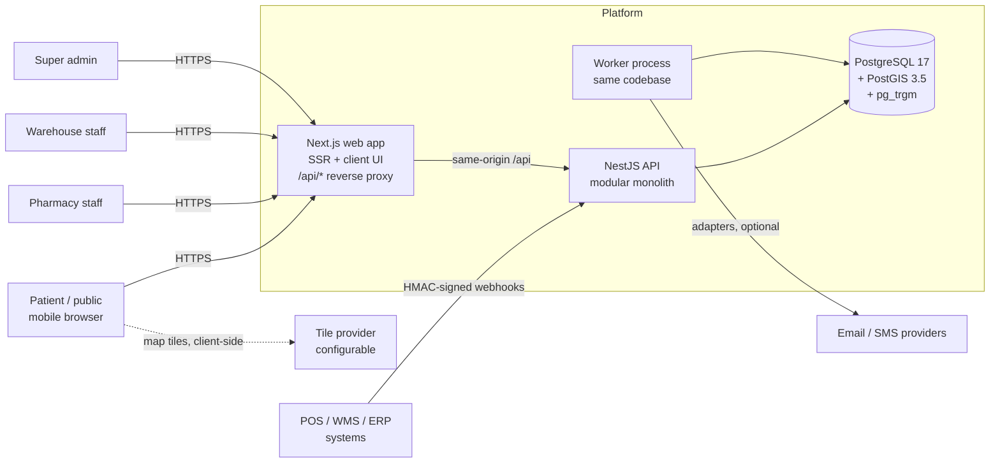
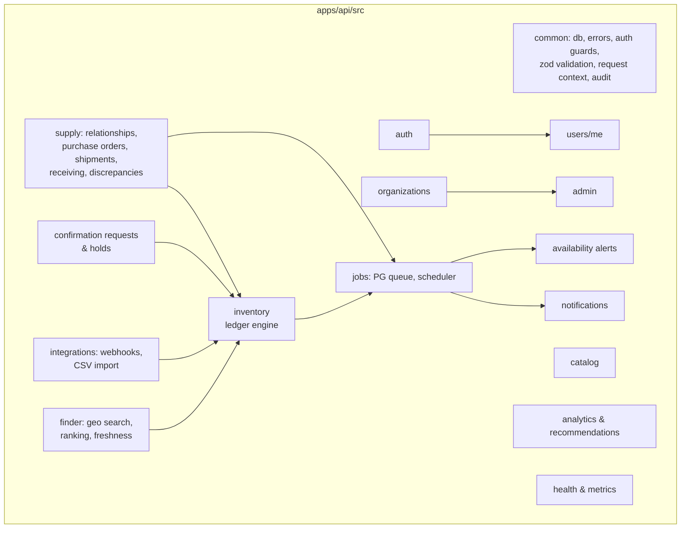

# 02 — System Architecture & Decisions

## 1. Context

* The browser only talks to the web origin. Next.js rewrites `/api/*` to the API, so there is no CORS, cookies are first-party, and the browser never calls `localhost`.
* The worker can run inside the API process (`WORKER_ENABLED=true`, used for the pilot) or as a separate process (`node dist/src/worker.js`) without code changes.

## 2. Modules (modular monolith)

Rules: modules talk to each other through exported services, never through each other's tables directly. The exception is read-only reporting queries in `analytics`/`finder`, which are documented. **All stock mutations go through `InventoryLedgerService` → the SQL function `sp_apply_inventory_movement`.**

## 3. Key flows & transaction boundaries

| Flow | Single DB transaction contains | Concurrency control |
|---|---|---|
| Stock adjustment | ledger movement + quantity update + audit + low-stock job enqueue | Row lock via `UPDATE`; optimistic `expectedVersion`; idempotency key unique index |
| PO confirm (warehouse) | lock PO (`FOR UPDATE`) → validate state → per line: lock warehouse item, reserve `confirmed_qty` (CHECK prevents oversell) → status change → history → notification jobs | Row locks in deterministic order (by inventory item id) to avoid deadlocks |
| Dispatch | lock shipment + PO → per item: warehouse `physical −q, reserved −q` (DISPATCH movement) → PO line `allocated −q, dispatched +q` → status | Same |
| Receipt (pharmacy) | lock shipment → validate status/ownership → per item: upsert pharmacy inventory item, `physical +received` (RECEIPT movement), batch → PO line counters → discrepancies → statuses → alert-matching job | Status check under lock makes a duplicate receipt impossible; idempotency key |
| Hold for patient | lock pharmacy item → `reserved +q` (CHECK prevents double booking) → reservation row | Two concurrent holds for the last unit: exactly one succeeds (tested) |
| Webhook event | insert `integration_events` (unique `(config, external_event_id)`) → apply snapshot/delta → mark processed | Duplicate event: unique violation → reported as `DUPLICATE`, no re-application |

Notifications and other side effects are written to the `jobs` table **inside the business transaction** (transactional outbox). They are only executed after commit, by the worker, with retry, backoff and dead-lettering.

## 4. Architecture decision records (ADRs)

| # | Decision | Alternatives considered | Rationale |
|---|---|---|---|
| ADR-01 | **Modular monolith** (one API codebase, optional separate worker process) | Microservices | One team, one DB, strong transactional needs (stock); microservices add distributed-transaction risk without a measured need |
| ADR-02 | **NestJS 11 + TypeScript 5.9** (CommonJS) | NestJS 12 (ESM-only), TS 7 native compiler | NestJS 12 is ESM-only and TS 7 is new; both add risk to decorator metadata and Jest tooling. Upgrading is on the roadmap |
| ADR-03 | **PostgreSQL 17 + PostGIS 3.5 + pg_trgm** | MongoDB, Elasticsearch | ACID stock changes, spatial indexes (`geography` + GiST), trigram fuzzy search in one engine |
| ADR-04 | **Hand-written SQL migrations + `pg`** (thin repositories) | Prisma, TypeORM | The critical logic lives in DB features (CHECK constraints, row locks, generated columns, PostGIS, triggers) that ORMs abstract poorly. SQL stays reviewable. The migration runner uses checksums, advisory locks and one transaction per file |
| ADR-05 | **Opaque server-side sessions** (SHA-256 hashed token, HttpOnly cookie) + HMAC-bound CSRF token | JWT access/refresh | Immediate revocation (suspension, logout everywhere) and no token theft window. Session reads are cheap indexed lookups |
| ADR-06 | **Self-hosted auth with vetted primitives** (argon2id, TOTP RFC 6238) | Auth0/Clerk/Keycloak | No third-party credentials are available, and Keycloak is too heavy for the pilot budget. The auth module is isolated so an OIDC IdP can replace it later |
| ADR-07 | **PostgreSQL job queue** (`FOR UPDATE SKIP LOCKED`) | Redis + BullMQ | Enqueue happens in the same transaction as the business change (outbox); one less piece of infrastructure. Redis is deferred until a measured need (e.g., multi-instance rate limiting) |
| ADR-08 | **One `organizations` table** (+ `pharmacies`/`warehouses` profile tables) and **one `inventory_items` table** | Separate PharmacyInventory/WarehouseInventory | Same quantity semantics and ledger; avoids duplicating the most critical engine and its invariants |
| ADR-09 | **Ledger-guarded stock**: quantities change only inside `sp_apply_inventory_movement` (trigger guard + append-only movements) | App-only discipline | Defense in depth against accidental direct updates; `sp_inventory_ledger_mismatches()` verifies sum(deltas) = balances |
| ADR-10 | **Confirmation requests + pharmacist-created holds** instead of patient self-reservations | Patient self-reservation | Counter sales are not synchronized; holds are only reliable when a pharmacist physically sets units aside |
| ADR-11 | **Single indexed spatial query + in-memory banding** | One query per band | One round trip; bounded candidate set (`LIMIT`), processed in 5/10/20/40 km bands; no full-table loads |
| ADR-12 | **Confirmation implies allocation** for POs | Separate "accept" then "allocate" steps | Removes the "accepted but unreserved" oversell window. Backorders are a roadmap item |
| ADR-13 | **Leaflet + configurable raster tiles; directions via deep links** | Google Maps JS (paid), Mapbox | No key needed for development; production can switch to MapTiler/Stadia/self-hosted tiles via env. If tiles fail, the list view and directions links still work |
| ADR-14 | **Zod schemas** for validation and OpenAPI generation (`z.toJSONSchema`) | class-validator DTOs | One source of truth, concise, strict (unknown keys rejected) |
| ADR-15 | **Cookie-based locale (ar default) + logical CSS properties** for RTL | Locale-prefixed routes | Simpler for MVP; SEO-friendly locale routes can come later |

## 5. Deployment topology (target)

* Containers: `web` (Next.js standalone), `api` (NestJS, `WORKER_ENABLED=false`), `worker` (same image, `start:worker`), managed PostgreSQL with PostGIS (backups + PITR), reverse proxy/CDN terminating TLS.
* Scaling: web and api are stateless (sessions live in the DB) and scale horizontally. Rate limiting is in-memory per instance in the MVP, so it needs Redis or the edge when there is more than one instance (documented limitation). The worker scales horizontally safely (`SKIP LOCKED`); scheduled tasks use advisory locks so they run once.

## 6. Cross-cutting concerns

* **Request context**: `AsyncLocalStorage` holds the request id (`x-request-id` is propagated or generated), actor, and IP hash. Pino structured logs include the request id. Cookies, authorization headers and passwords are redacted.
* **Errors**: one error envelope `{ error: { code, message, details?, requestId } }`. PostgreSQL errors are mapped (`23514` check violation → `409 STOCK_CONSTRAINT_VIOLATION`, `23505` → `409 CONFLICT`, `40P01` deadlock → `503` retryable).
* **Time**: all timestamps are `timestamptz` (UTC). Display uses the organization timezone (default `Africa/Cairo`). "Open now" is computed in that timezone.
* **Money**: `numeric(12,2)` with a currency code; never floating point.
