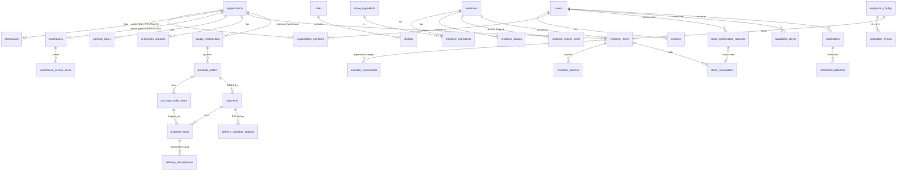

# 03 — Data Model & Schema

Source of truth: `apps/api/db/migrations/*.sql` (applied by `migrate.cli`, checksummed, one transaction per file, advisory-locked). Never edit an applied migration — add a new file.

## Entity-relationship diagram (core)

Supporting tables: `system_settings`, `audit_logs` (append-only), `security_events`, `status_history` (append-only), `jobs` (queue/outbox), `idempotency_records`, `inventory_imports`, `search_events` (privacy-preserving), `schema_migrations`.

## Deliberate deviations from the recommended entity list (and why)

| Recommended | Implemented as | Reason |
|---|---|---|
| Pharmacies / Warehouses / PharmacyStaff / WarehouseStaff | `organizations` + 1:1 `pharmacies`/`warehouses` + `organization_members` | One tenant model and one authorization path for both org types; no duplicated staff logic. |
| PharmacyInventory / WarehouseInventory | single `inventory_items` (+ `inventory_movements`) | One ledger engine and one set of invariants for every stock holder; warehouse allocation and pharmacy holds reuse the same `reserved` concept. |
| Roles / Permissions tables | fixed matrix in code (`permissions.ts`), roles on membership | Prevents privilege escalation by configuration; reviewed in code and unit-tested. Exposed read-only at `/admin/permissions`. |
| Suppliers | warehouses + `supply_relationships` | Suppliers are verified warehouse organizations; external suppliers can be recorded via stock adjustments (`RECEIVE_EXTERNAL`). |
| DeliverySchedules | columns on `shipments` + `delivery_schedule_updates` history | Current schedule is queryable; every change is preserved. |
| AvailabilityRequests | `stock_confirmation_requests` (+ optional pharmacist hold) | Patients never reserve stock directly (see docs/06). |

## Integrity rules enforced by the database

- **Quantities** are `integer`, money is `numeric(12,2)`, timestamps are `timestamptz` (UTC).
- `inventory_items`: `physical, reserved, unavailable >= 0`; `available = physical − reserved − unavailable` is a **generated column** with `CHECK (available >= 0)` → overselling and double allocation are impossible even under concurrency.
- Quantities can change **only** inside `sp_apply_inventory_movement` (trigger `inventory_items_guard` rejects direct updates/inserts with stock). Each change writes a movement with deltas and post-balances; `(item, idempotency_key)` is unique.
- `inventory_movements`, `audit_logs`, `status_history` are append-only (triggers raise on UPDATE/DELETE).
- `purchase_order_items`: `confirmed ≤ requested`, `allocated + dispatched ≤ confirmed`, `received + damaged + missing ≤ dispatched`.
- `shipment_items`: once received, `received + damaged + missing = quantity` (nothing silently discarded).
- `medicines.identity_key` unique (ingredients+strengths, form, route, package, manufacturer, brand); partial unique barcode / registration number.
- `notifications (user_id, dedupe_key)` and `jobs (dedupe_key)` partial uniques provide deduplication; `integration_events (config, external_event_id)` unique provides webhook idempotency.
- `sp_inventory_ledger_mismatches()` returns any item whose balances differ from the sum of its ledger (expected: zero rows; exposed at `GET /admin/ledger-check`).

## Key indexes

| Index | Purpose |
|---|---|
| `organizations_searchable_pharmacy_gix` (GiST, partial: verified+active pharmacies) | spatial candidate search |
| `inventory_items_medicine_idx (medicine_id) INCLUDE (...)` | medicine-first finder plan |
| `medicine_search_terms` GIN trigram on normalized term + skeleton | AR/EN fuzzy catalog search |
| `jobs_ready_idx (run_at) WHERE status IN (PENDING, FAILED)` | queue polling with `SKIP LOCKED` |
| partial indexes on open shipments, active reservations, pending requests | worker sweeps and dashboards |

## Arabic/English normalization (SQL, immutable)

`sp_normalize_text`: lower-case, strip Arabic diacritics/tatweel, unify alef/yaa/taa-marbuta variants, Arabic-Indic digits → ASCII, unaccent Latin.
`sp_search_skeleton`: transliterates Arabic to Latin consonants and folds Latin spelling variants (ph→f, x→ks, c→k/s, p→b, v→f, vowels dropped) so *Panadol / بانادول / بنادول* → `bndl`, *Augmentin / أوجمنتين* → `agmntn`, *Ceftriaxone / سيفترياكسون* → `sftrksn`. Verified by direct SQL tests (see docs/10).
