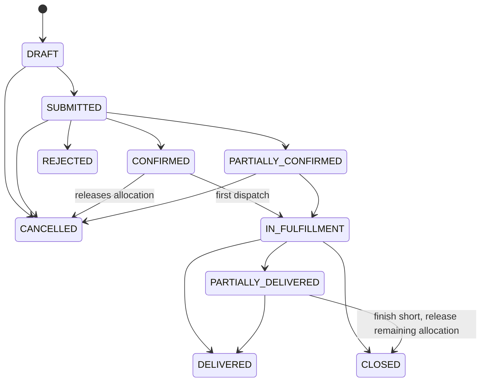

# 07 — Supply Chain: Orders, Allocation, Shipments, Receiving

## Separate quantity concepts (per order line)
`requested` (pharmacy) → `confirmed` (warehouse decision) → `allocated` (reserved in warehouse stock, not yet shipped) → `dispatched` (left the warehouse) → `received` / `damaged` / `missing` (pharmacy verification). DB checks: `confirmed ≤ requested`, `allocated + dispatched ≤ confirmed`, `received + damaged + missing ≤ dispatched`.

## Purchase order state machine

Mapping to the requested status vocabulary: *Allocated* = CONFIRMED/PARTIALLY_CONFIRMED (confirmation **implies** allocation in the same transaction — no oversell window); *Dispatched / In transit / Delayed* are tracked per **shipment** (an order can have several); *Partially fulfilled* = PARTIALLY_CONFIRMED or PARTIALLY_DELIVERED. Invalid transitions return `409 INVALID_STATE_TRANSITION`. Cancellation is impossible once goods are dispatched (use *close*).

## Shipment state machine
`DRAFT → DISPATCHED → IN_TRANSIT ⇄ DELAYED → ARRIVED → DELIVERED | PARTIALLY_DELIVERED`; `DRAFT → CANCELLED`. Receipt outcomes can only be set by the receiving pharmacy. Delay requires a reason.

## Transaction boundaries
| Operation | Atomic effects (single DB transaction, row locks in deterministic order) |
|---|---|
| Confirm PO | lock PO → lock warehouse stock rows (ordered by id) → `ALLOCATION` movements (`reserved += qty`) → set confirmed/allocated → status history → audit → notification outbox |
| Cancel/close PO | `ALLOCATION_RELEASE` movements for outstanding allocation; drafts cancelled |
| Dispatch | `allocated −= q, dispatched += q`; warehouse `DISPATCH` movement (`physical −= q, reserved −= q`). **Pharmacy stock unchanged.** |
| Receive | per line: `received/damaged/missing` (missing = shipped − received − damaged); pharmacy `RECEIPT` movement for received units only (optionally into quarantine: `receiving.quarantineOnReceipt`); batch/expiry carried over; discrepancy rows for damaged and missing; shipment + PO status recomputed; warehouse notified |

All mutating operations accept `Idempotency-Key`; replays return the stored response. A failure in any line rolls back the whole receipt (integration-tested with an injected constraint failure).

## Delivery dates
Each shipment stores `estimated_delivery_at`, `schedule_confidence` (CONFIRMED / ESTIMATED / PENDING_CONFIRMATION / UNKNOWN) and `schedule_updated_at`; every change is appended to `delivery_schedule_updates` with `is_delay`. The displayed label is derived consistently: an open shipment past its ETA shows **DELAYED** even if the warehouse has not updated it; the worker notifies both parties once per ETA when overdue.

## Discrepancies
Created automatically at receipt (`DAMAGED`, `MISSING`); the warehouse can acknowledge, dispute or resolve (`CREDIT_ISSUED`, `REPLACEMENT_PLANNED`, `WRITTEN_OFF`, `REJECTED`) with notes; the pharmacy is notified. Replacement shipments are created as a new order (automatic replacement orders are not implemented).

## Supplier comparison
Computed only from recorded, completed data with sample sizes exposed; rates (confirmation, on-time against the first communicated ETA, discrepancy) return `null` = "insufficient data" below 3 observations — never guessed.
